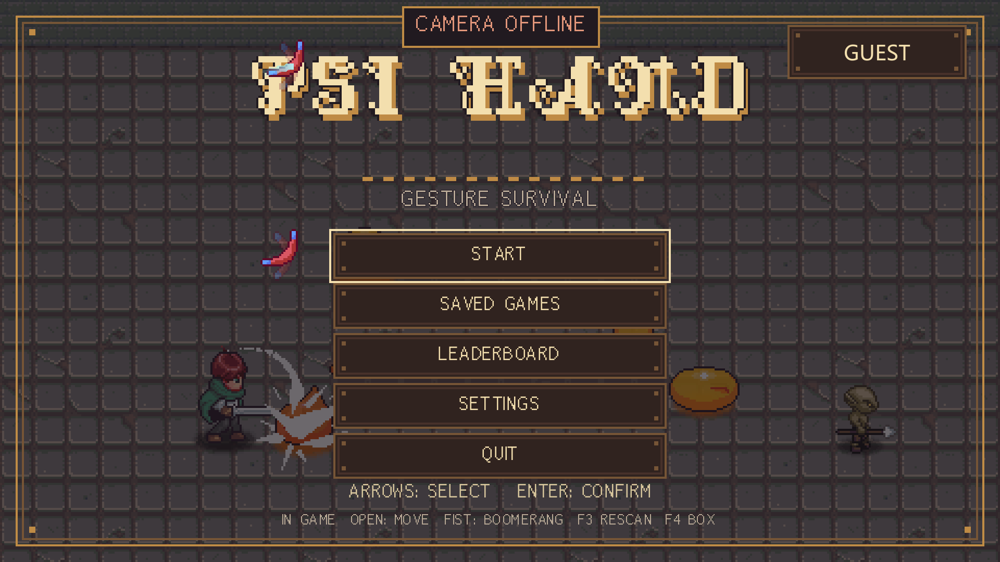

# PSI HAND

[](docs/releases/v1.2.0.md)
[](project.godot)
[](#工作原理)
[](#安装)

一款用摄像头玩的 2D 像素生存游戏。**张掌走位，握拳控镖，松手收回**。穿过地牢和草地，用清波后选到的强化搭配打法，最后挑战巫师 Boss。没有摄像头也能用键盘打完整局。



*v1.1.0 Windows 候选包实机截图，游客模式。*

## 功能特点

- **手势战斗**：角色跟随手掌的位置走动，敌人靠近时自动挥剑。握拳后角色站定，回旋镖跟着手走，可以绕到盾兵背后攻击。
- **三关生存**：地牢和草地各有三波战斗，最后一关对战巫师。击败敌人后可拾取物品，指定波次结束后从三种随机强化中选一项。
- **随时续玩**：支持手动存档和波次自动存档。游客可离线游玩，登录后可同步存档和个人最高击杀数。
- **线上排行榜**：先比较闯关进度，同进度再比较有效用时。游客联网即可浏览，登录并取得排名资格的新局才能提交成绩。

## 安装

从 [Releases](https://github.com/cjhDuke/AARPG-Gesture/releases) 下载 `AARPG-Gesture-win-x64-Setup.exe`，安装后从开始菜单或桌面打开 **PSI HAND**。在主菜单选择 **START**。登录提示可用 **X** 或 **Esc** 关闭。

每次打开游戏都会后台检查更新。有新版时可选 **UPDATE & START**，游戏优先下载差分更新，安装完成后会自动重开。选 **LATER** 可继续当前版本。差分不可用时会下载整包。

从旧 ZIP 版升级时，先运行一次新版安装器。游戏会继续读取同一 Windows 用户的存档、账号数据和设置。要迁移旧操作框位置，在标题的 **SETTINGS → AUDIO → IMPORT GESTURE SETTINGS** 选择旧目录中的 `gesture/state.json`。先保管好旧目录里的录像和截图，之后可自行清理旧 ZIP 和解压目录。此后的安装版更新会清理废弃程序文件，保留安装版写入用户目录的手势状态、录像和截图。

键盘模式无需 Python。想用手势时，连接摄像头并把 Python 3.12 加入 Windows 的 `PATH`，然后在安装目录运行下列命令。安装目录默认位于 `%LOCALAPPDATA%\AARPG-Gesture\current`。

```powershell
python -m pip install -r gesture/requirements.txt
```

装好依赖后重启游戏，识别进程会自动启动。使用虚拟环境时，可从已激活环境的终端运行安装目录里的 `PSIHand.exe`。

## 操作

| 按键 | 操作 |
| --- | --- |
| **WASD** 或方向键 | 移动 |
| **Z** 或 **J** | 手动挥剑，敌人进入近战范围时也会自动挥剑 |
| 按住 **L**，配合移动键 | 站定并引导回旋镖，松开 **L** 后收回 |
| **Q** / **E** | 分别使用背包中的苹果 / 药水 |
| **Esc** | 暂停或返回 |

使用摄像头时，看到 **KEEP HAND OUT** 先把手移出操作框，等 **READY - HAND IN** 出现后再伸手。**F3** 重新采集背景，**F4** 切换操作框。菜单用键盘或鼠标操作。

## 工作原理

这是一个数字图像处理课程项目。识别在本机运行，使用 OpenCV 的传统图像处理方法，无需训练模型。

1. 将摄像头画面转换到 YCrCb，结合背景差分、肤色掩膜和连通域提取手部。
2. 用距离变换找掌心，排除小臂后用轮廓张开度和实心度区分张掌与握拳。
3. 对掌心位置和手形做平滑与防抖，再通过本机 UDP 把识别结果传给 Godot。

光线突变、脸进入操作框或手指伸出画面时，识别可能不稳。可以切换操作框或重新采集背景，也可以切回键盘。

## 开发

用 Godot 4.6.3 打开 [project.godot](project.godot) 后按 **F5** 运行。手势识别依赖与 Windows 包相同。

| 入口 | 职责 |
| --- | --- |
| [`gesture/`](gesture/) | Python 手势识别、摄像头与跟踪 |
| [`autoload/gesture_input.gd`](autoload/gesture_input.gd) | 接收手势数据并交给游戏 |
| [`levels/survival/`](levels/survival/) | 生存关卡、敌人波次与强化 |

## 许可

代码以 [MIT 许可](LICENSE) 发布。角色、地图、音效、字体和 UI 素材的授权见 [第三方素材与许可](THIRD_PARTY_NOTICES.md)。

## 致谢

角色、地图和部分音效来自 Michael Games 的教程素材。UI 图集来自 Kibyra，强化图标来自 Quintino Pixels。字体采用 DungeonFont 和 Abaddon Light。完整署名见 [第三方素材与许可](THIRD_PARTY_NOTICES.md)。
