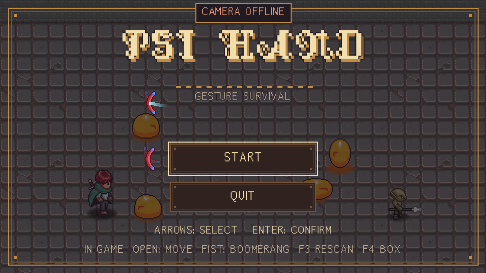
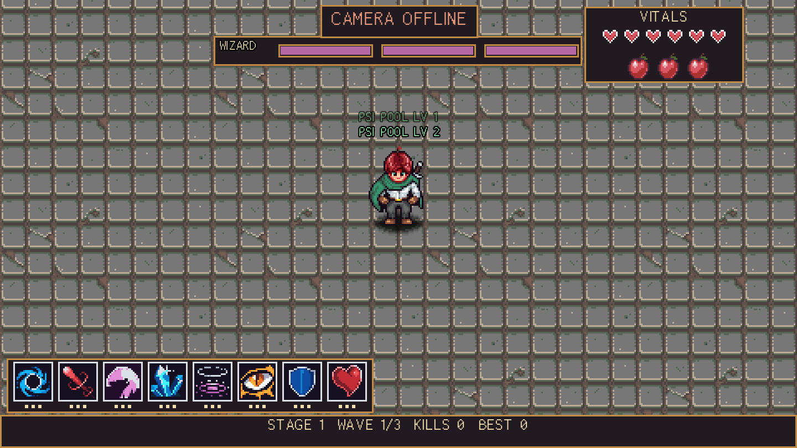
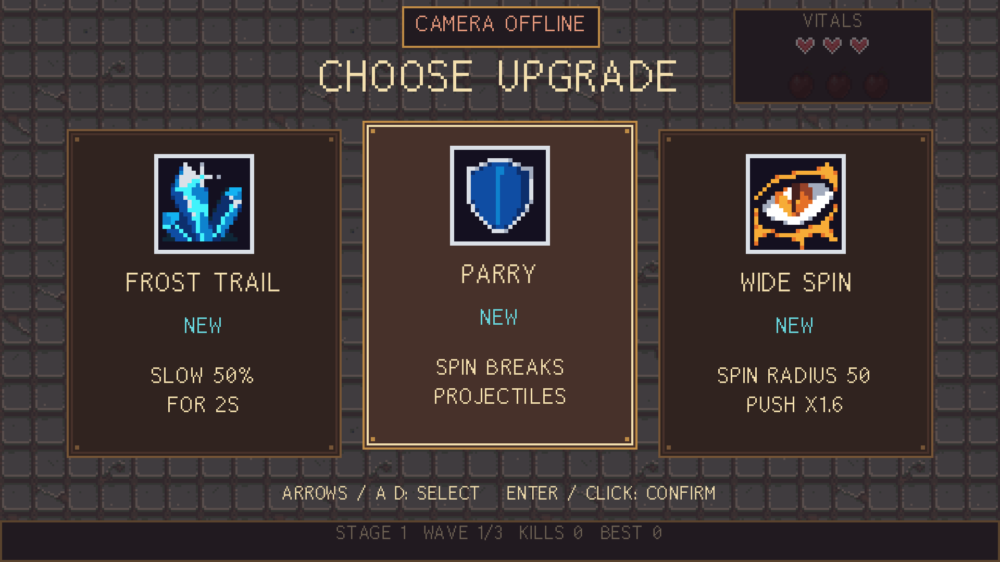

# PSI HAND

**PSI HAND** 是 AARPG-Gesture 仓库中的一款 2D 像素生存游戏，也是一个数字图像处理课程项目。张开手掌引导角色走位，握拳用念力操控回旋镖，松开拳头让回旋镖返回。你将在地牢和草地迎战多波敌人，从三项强化中选择一项，最后挑战巫师 Boss。没有摄像头也可以用键盘完成游戏。

## 游戏截图

| 标题画面 | 生存战斗 | 强化三选一 |
| --- | --- | --- |
|  |  |  |

## Windows 游玩

Windows 包待发布，发布后可在 [GitHub Releases](https://github.com/cjhDuke/AARPG-Gesture/releases) 获取。下载 Windows ZIP 后，先完整解压到同一文件夹，保留可执行文件旁的配套文件和目录，再运行 `AARPG-Gesture.exe`。在标题菜单选择 **START** 开局。

键盘默认可玩，无需安装 Python 或连接摄像头。登录提示可用右上角 **X** 或 **Esc** 关闭。游客可以离线游玩并使用本地存档，联网时可以浏览公开排行榜。登录后可同步账号存档与个人击杀纪录 **BEST KILLS**，符合资格的新局可提交线上成绩。

### 键盘操作

| 按键 | 操作 |
| --- | --- |
| **WASD** 或方向键 | 移动 |
| **Z** 或 **J** | 手动挥剑，敌人进入近战范围时也会自动挥剑 |
| 按住 **L**，配合移动键 | 站定并引导回旋镖，松开 **L** 后收回 |
| **Q** / **E** | 分别使用背包中的苹果 / 药水 |
| **Esc** | 暂停或返回 |

### 摄像头手势

1. 连接摄像头并安装 Python 3.12。确认 Windows 终端能运行 `python --version`，再在解压目录中安装识别依赖 OpenCV 和 NumPy。

   ```powershell
   python -m pip install -r gesture/requirements.txt
   ```

2. 启动或重启游戏，客户端会自动启动识别进程。如果使用独立的 Python 环境，请先激活该环境并从同一终端启动游戏，或将 `gesture/config.json` 中的 `python` 指向已安装依赖的解释器。
3. 看到 **KEEP HAND OUT** 时，将手移出摄像头操作框。出现 **READY - HAND IN** 后伸手开始操作。按 **F3** 可重采背景，按 **F4** 可切换操作框。菜单使用键盘或鼠标操作。

## 传统图像处理管线

Python 端对摄像头画面做高斯滤波并转换到 YCrCb，用背景差分和肤色掩膜筛出前景，再用形态学和连通域提取手部。距离变换用于定位掌心并估计掌心半径。识别端排除小臂后计算轮廓张开度，结合实心度区分张掌与握拳，经时序防抖和平滑后，通过本机 UDP 把手势和位置传给 Godot。整个识别流程使用 OpenCV 等传统图像处理方法，无需训练模型。

## 从源码运行

使用 Godot 4.6.3 打开 [project.godot](project.godot)，运行项目即可进入游戏。手势依赖的安装方法与 Windows 包相同，在仓库根目录执行上面的命令即可。

- [标题场景](ui/title/title_scene.tscn) 是客户端主场景。
- [生存关卡](levels/survival/) 包含波次、强化和手势战斗逻辑。
- [Python 识别入口](gesture/main.py) 与 [Godot 手势接收端](autoload/gesture_input.gd) 分别负责识别和接收手势状态。

## 素材归属

角色、地图和部分音效使用了 Michael Games 的教程素材。UI 图集来自 Kibyra，强化图标来自 Quintino Pixels，界面使用 DungeonFont 和 Abaddon Light。作者、来源与许可记录见 [第三方素材与许可](THIRD_PARTY_NOTICES.md)。
